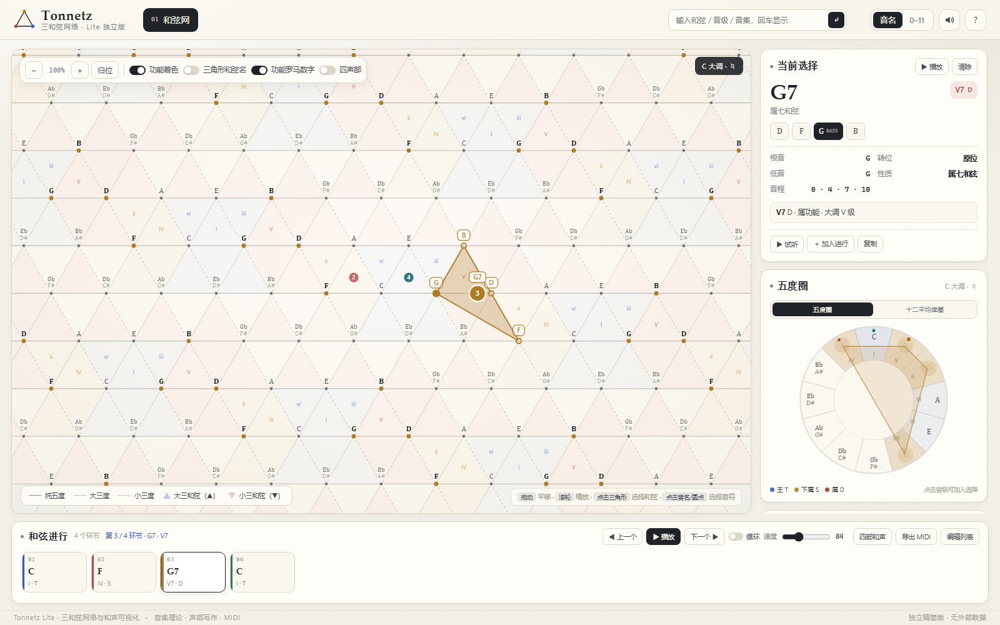
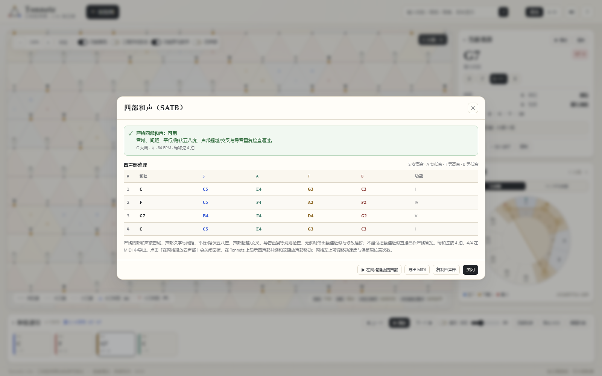

# Tonnetz Lite

**把十二平均律的三和弦放回一张可拖动、可缩放、能听见的音网。**

纯静态 · 零依赖 · 离线可用 · MIT License

当前版本：**v0.1.0（首个开源整理版）**

Tonnetz Lite 是一个面向和声学习、教学演示与作曲探索的浏览器工具。它把 Tonnetz（音网）作为主界面：横向是纯五度，右上斜向是大三度，右下斜向是小三度；每个三角形就是一个三和弦。你可以在同一张网里选择和弦、输入音集、查看调性功能、编排进行、检查严格四部和声，并导出 MIDI。

> 本项目由音乐爱好者制作，不是专业音乐理论或出版软件，分析结果仅供参考。项目仍在持续调试，欢迎通过 Issue 反馈问题。本整理版不包含视频录制脚本、录屏素材与视频成品。



## 为什么用 Tonnetz

传统和弦表把和弦逐个列出，Tonnetz 则把和弦之间的关系画成几何邻接：相邻的三角形共享两个音，因此“共同音连接”“五度关系”“三度关系”可以直接看见。Tonnetz Lite 在这个空间关系上叠加了调性功能（T / S / D）、罗马数字、和弦进行与四声部写作，让“看见关系”和“听见结果”发生在同一个界面。

## 功能

- **无限音网**：拖动平移、滚轮缩放、一键归位；点击三角形选择和弦、填色、显示名称并试听。
- **多种输入**：和弦符号、斜杠转位、音名列表、带八度音名、0–11 音集。
- **调性与功能**：12 个主音、大小调与教会调式；T / S / D 着色、调号、罗马数字与功能解释。
- **五度圈 / 十二平均律圈**：两种视图功能一致；切换调性时主音转到 12 点方向，音名始终保持水平；支持音名与 0–11 数字显示切换。
- **和弦进行**：多行批量输入、逐环编号、播放 / 暂停 / 循环 / 速度控制，网格、圆圈与右侧读数同步。
- **严格四部和声**：整理 S / A / T / B，检查音域、间距、平行与隐伏五度八度、声部超越/交叉、导音与七音解决、重复音等；无解时给出问题点、最佳近似与修改建议。
- **四声部网格动画**：在音网上显示四个声部及其移动轨迹，可调移动速度与保留原位置次数。
- **MIDI 导出**：一般流行风格（钢琴柱式和弦）或严格四部和声（四个独立声部轨）。
- **音集理论读数**：音程向量、原型、标准型等基础信息，配合 0–11 输入观察十二音关系。
- **完全离线**：没有 CDN、没有后端、没有遥测；本地版断网可用，声音由浏览器 Web Audio 实时合成。

## 快速开始

### Windows（推荐）

1. 下载 Release 中的 `Tonnetz-Lite-v0.1.0.zip` 并完整解压。
2. 双击 **`launch.cmd`**。
3. 浏览器会自动打开 `http://127.0.0.1:8850/`（端口被占用时自动顺延到 8870）。

不需要安装 Python、Node.js 或任何运行时。停止服务请双击 **`stop.cmd`**。

### macOS / Linux

需要 Python 3.8+：

```bash
cd Tonnetz-Lite
chmod +x start.sh
./start.sh
```

也可以直接运行：

```bash
python3 serve.py
```

然后打开终端显示的地址。按 `Ctrl+C` 停止。

> **不要直接双击 `index.html`。** 页面使用 ES Module，必须通过 HTTP 服务访问，否则浏览器会阻止模块加载。

更完整的安装、更新、卸载与 GitHub Pages 部署说明见 [安装指南](docs/安装指南.md)。

## 三分钟上手

在“编辑列表”中输入：

```text
G | Em | C | D
```

点击“解析并载入”，再按“播放”。你会看到网格中的和弦依次高亮，圆圈上的进行色点同步移动。把调性设为主音 **G**、调式 **大调**，即可观察这组 I–vi–IV–V 的 T / S / D 功能与罗马数字。

再试试严格四部和声：

```text
C | F | G7 | C
```

点击底部“四部和声”，查看 SATB 整理结果与检查状态；绿色表示严格可用，琥珀色表示硬性规则通过但有复核项，红色表示严格无解。

更系统的操作说明、案例和练习见 [使用教程](docs/使用教程.md)，全部可输入写法见 [输入语法](docs/输入语法.md)。

## 四部和声



严格 SATB 检查会在下列维度上给出问题点或建议：

- 声部音域与相邻声部间距；
- 平行五度、平行八度、隐伏五度/八度；
- 声部超越与交叉；
- 导音、和弦七音的解决与重复音；
- 当前调性下的和弦功能与转位。

当进行无法满足全部硬性规则时，程序会给出“最佳近似”，并禁用严格 SATB 的 MIDI 导出。最佳近似适合用来定位问题，不应直接当作严格答案。

## 文档

| 文档 | 内容 |
|---|---|
| [安装指南](docs/安装指南.md) | Windows 一键启动、macOS/Linux、GitHub Pages、更新与卸载、故障排查 |
| [使用教程](docs/使用教程.md) | 从第一个和弦到进行、SATB、四声部动画与 MIDI 导出的完整流程 |
| [输入语法](docs/输入语法.md) | 和弦符号、转位、音名、音集、进行分隔符与 0–11 对照 |
| [开发与架构](docs/开发与架构.md) | 目录结构、模块职责、数据流、扩展方式与手工验收清单 |
| [常见问题](docs/常见问题.md) | 空白页、没有声音、端口占用、SATB 无解、MIDI 等 |
| [发布到 GitHub](docs/发布到GitHub.md) | 初始化仓库、推送、Release、GitHub Pages 与仓库设置 |
| [更新日志](CHANGELOG.md) | v0.1.0 的包含内容、整理项与已知限制 |
| [参考资料](docs/参考资料.md) | 和声、音集理论与 Tonnetz 相关书目及链接 |

## 技术说明

Tonnetz Lite 没有构建步骤：浏览器直接加载 `index.html` 与 `assets/js` 下的 ES Module。界面使用 Canvas 2D 绘制音网与圆圈，声音使用 Web Audio API 实时合成，MIDI 使用项目内的轻量 SMF 写入器生成。

```text
Tonnetz-Lite/
├─ index.html                 # 单页面入口
├─ launch.cmd / stop.cmd      # Windows 一键启动 / 停止
├─ launcher.ps1               # 端口选择与浏览器启动
├─ lite-server.ps1            # 仅监听 127.0.0.1 的静态服务器
├─ stop-server.ps1            # 只停止本目录的服务器
├─ create-shortcut.cmd/.ps1   # 创建项目内与桌面快捷方式
├─ serve.py                   # 零依赖跨平台本地服务器
├─ start.sh                   # macOS / Linux 启动脚本
├─ assets/
│  ├─ css/app.css
│  ├─ js/
│  │  ├─ core.js              # 乐理内核、解析、调性、功能
│  │  ├─ audio.js             # Web Audio 合成器
│  │  ├─ tonnetz.js           # 音网、圆圈、四声部动画
│  │  ├─ satb.js              # 严格四部和声分析
│  │  ├─ midi.js              # SMF 导出
│  │  └─ app.js               # 页面控制器
│  ├─ icon.ico / icon.png
│  └─ screenshots/
├─ docs/
└─ .github/workflows/pages.yml
```

本项目不读取 `assets/data`，不加载外部 JSON，不依赖完整版 Tonnetz，也不包含原始工作簿、桌面程序或模板数据库。

### 本地验证

```bash
# 检查 Python 服务器语法
python3 -m py_compile serve.py

# 启动并检查核心资源
python3 serve.py --port 8850 --no-browser
curl -I http://127.0.0.1:8850/
curl http://127.0.0.1:8850/api/ping
```

浏览器控制台应无 404 或模块加载错误。手工验收步骤见 [开发与架构](docs/开发与架构.md#验收清单)。

## 隐私与离线

- 页面、脚本、图标、截图全部随项目分发，**没有外部网络请求**。
- 不收集任何使用数据，没有统计、账号或云端同步。
- 本地服务器只监听 `127.0.0.1`；`launch.cmd` 与 `serve.py` 都不会暴露到局域网。
- 浏览器只为“五度圈 / 十二平均律圈”的选择写入一个 `localStorage` 键：`tonnetz-lite:circleMode`。

## 已知限制

- **非专业软件**：和声分析、音集命名与 SATB 建议仅用于学习与辅助，不替代教师、教材或人工校验。
- **严格四部和声有边界**：5–8 个音的扩展和弦可能被省略音或要求复核；自由音集通常会被判定为无法直接四部写作；9 个音以上通常无法在四个声部中完整呈现。
- **桌面端优先**：界面为宽屏工作台设计，小屏幕和触屏体验尚未专门优化。
- **音频需一次用户操作**：受浏览器自动播放策略限制，首次点击页面后才会有声音。
- **MIDI 为基础导出**：4/4、每和弦 4 拍，不包含力度编辑、歌词、演奏法与多段结构。
- **暂无工程保存**：刷新页面后进行不会保留；如需保存请先导出 MIDI 或复制四声部文本。
- **仍在校对**：乐理细节、拼写与边界案例可能继续调整。

## 参与贡献

欢迎提交 Issue 与 Pull Request。请先阅读 [CONTRIBUTING.md](CONTRIBUTING.md)。尤其欢迎以下方向的反馈：

- 和声规则与音集命名的错例、边界案例；
- 浏览器兼容性与可访问性；
- 输入语法、教学案例与文档改进；
- 不引入外部依赖的性能优化。

## 许可证

代码与随附文档、图标、界面截图以 [MIT License](LICENSE) 发布。当前版权人写为 “Tonnetz Lite contributors”；发布到自己的仓库前，可按实际署名替换 `LICENSE` 中的版权行。第三方书名、理论名称与链接归各自权利人所有；本项目未复制第三方代码或数据。

## 参考资料

- 叶小胖《图解和声 基础篇》，豆瓣阅读：<https://read.douban.com/reader/ebook/51427187/?dcs=bookshelf>
- Hugo Riemann, *Harmony Simplified* (1896)
- Allen Forte, *The Structure of Atonal Music* (1973)
- David Lewin, *Generalized Musical Intervals and Transformations* (1987)
- Richard Cohn, *Audacious Euphony* (2012)
- Dmitri Tymoczko, “The Geometry of Musical Chords”, *Science* 313 (2006)

完整说明见 [参考资料](docs/参考资料.md)。

---

### English

Tonnetz Lite is a dependency-free, offline browser tool for exploring triadic voice-leading on a Tonnetz grid. It includes key-aware harmonic functions, a circle of fifths / chromatic circle, chord-progression playback, strict SATB analysis, four-voice animation, pitch-class set readouts, and MIDI export. The UI and documentation are in Chinese. See [INSTALL](docs/安装指南.md) and [TUTORIAL](docs/使用教程.md) for details; the source is MIT licensed.
